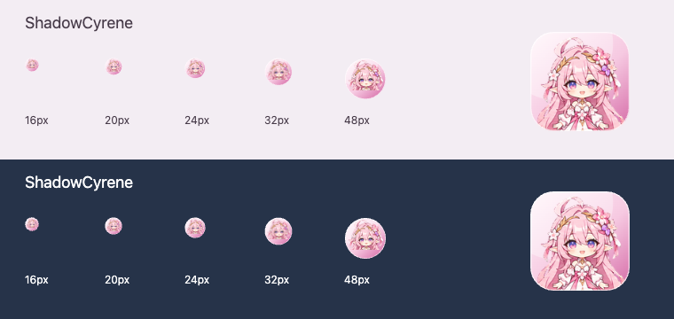
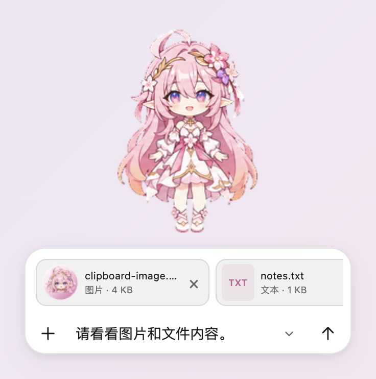

<p align="center">
  
</p>

<h1 align="center">ShadowCyrene</h1>
<p align="center">A desktop companion for macOS & Windows, with cursor-following gaze and optional Codex chat.<br>跟随目光、拖动跑步、粉色消息和可收起 Chat 栏的独立桌宠。</p>
<p align="center"><a href="https://github.com/shadows204/ShadowCyrene-DeskPet-Codex/releases/latest">下载 Download</a> · <a href="#安装">安装</a> · <a href="#直接聊天与检测插件">连接 Chat</a> · <a href="#开发与构建">源码构建</a></p>

**ShadowCyrene 在所有语言中使用同一个名字。** 界面支持简体中文、繁體中文、English、Français、日本語。这是独立的非官方同人程序，不修改 ChatGPT/Codex 安装文件。

## 功能

- **目光跟随**：眼睛连续追随全局鼠标，头部轻微移动；站立时身体保持固定。当前为 2.5D 渲染，不是 Cubism/Live2D 模型。
- **拖动跑步**：使用原有左右动画，步频根据拖动速度和人物缩放调整；松开或停住后恢复站立。可开启“减少动态效果”。
- **短 Chat 栏**：固定在人物下方，可收起为圆钮并保留草稿；靠近屏幕底角时自动移至左下或右下。
- **可选直接聊天**：配套检测插件连接后，使用本机官方 Codex CLI 登录账户的桌宠专属会话，支持流式回复和停止。其余情况下复制文字并打开官方应用。
- **粉色对话显示**：最近一行或 5–7 行，旧内容向上渐隐。消息靠屏幕中心一侧，额度框靠边缘一侧，贴边时自动让位。
- **额度气泡**：单击人物显示 3 秒。读取实际 Codex/Work 的 5 小时及每周额度、套餐与重置时间。
- **任意位置与缩放**：人物可拖到四角；整体、人物、Chat 栏、消息及额度框可分别调为 50–200%。
- **菜单栏／托盘**：macOS 菜单栏、Windows 托盘常驻；Windows 不显示任务栏按钮，可随时隐藏并唤回。

## 安装

从 [Releases](https://github.com/shadows204/ShadowCyrene-DeskPet-Codex/releases/latest) 下载 **0.5.0** 对应的 ZIP：

| 系统 | 文件 | 使用方式 |
| --- | --- | --- |
| macOS · Apple Silicon | `ShadowCyrene-0.5.0-macOS-arm64.zip` | 解压，将 `ShadowCyrene.app` 拖至应用程序目录 |
| macOS · Intel | `ShadowCyrene-0.5.0-macOS-x64.zip` | 同上 |
| Windows 10/11 · x64 | `ShadowCyrene-0.5.0-Windows-x64.zip` | 完整解压，运行 `ShadowCyrene.exe`，不要单独移动 EXE |

macOS 在 Apple Silicon 本机测试。Intel Mac 与 Windows x64 完成构建、架构、图标资源和包内容核对，尚未真机验证；暂未提供 Windows ARM 原生包。

这是个人构建，未做 Apple 公证或 Windows Authenticode 签名；若系统拦截，请使用系统提供的打开确认入口。程序不会自动设置开机启动。

## 显示和操作

| 操作 | 效果 |
| --- | --- |
| 拖动人物 | 移动并播放对应方向的跑步动画 |
| 单击人物 | 显示额度气泡 3 秒；拖动不会误触 |
| 双击人物 | 挥手 |
| 右键人物／托盘图标 | 打开菜单、语言、缩放和连接设置 |
| Option + Space / Alt + Space | macOS / Windows 唤出并聚焦 Chat；冲突时回退至加 Shift 的组合 |
| Chat ＋号 | 添加文件或图片 |
| 在输入框粘贴／拖放文件至 Chat | 添加图片或文件附件 |
| Chat 下箭头／圆钮 | 收起／展开，草稿保留 |
| Enter / Shift + Enter | 发送／换行 |
| Esc | 隐藏桌宠 |
| Windows 托盘单击 | 显示／隐藏桌宠；右键托盘可退出 |

粘贴说明只在确认官方 GPT 应用未打开时显示。直发模式、官方应用已打开或检测状态未知时均隐藏该说明。

Windows 即使展开 Chat 也不占任务栏；最小化或关闭窗口会隐藏到托盘，通过托盘菜单“退出”才会结束程序。macOS 通过菜单栏操作。

### 修复后的图标

应用图标使用大幅头像；菜单栏和 Windows 托盘使用独立头像裁切，避免整张人物图缩小后只剩一个点。包含 Retina 图标和多尺寸 Windows ICO，并将图标嵌入 Windows EXE。



## 直接聊天与检测插件

1. 在本机登录官方 ChatGPT/Codex 及官方 Codex CLI。缺少 CLI 时，从桌宠“连接设置”选择官方 `codex` / `codex.exe`；登录由官方 CLI 管理。
2. 桌宠右键 → **安装／更新配套检测插件**。本机会创建 `shadowcyrene-local` 来源并安装 `shadowcyrene-bridge`，显示名称为 **ShadowCyrene**。
3. 在官方客户端刷新插件，或在下次新会话中加载。实际 MCP 进程加载后才视为连接，不会把“已安装”伪装成“已在线”。
4. 满足 **官方客户端运行 + 检测插件已连接 + 登录及额度连接就绪** 三个条件，Chat 自动切换到直接发送。
5. 在桌宠输入并发送，回复显示在桌宠旁。右键“桌宠会话”可选择接口返回的模型、新建对话或停止回复。发送失败保留草稿，不自动重发；提交状态未知时先查看回复，避免重复发送。

直接聊天会消耗对应订阅额度。它是**同账户的桌宠专属 Codex/Work 会话**，不接管官方当前聊天，不向官方输入框自动粘贴，也不是普通 ChatGPT 各模型的聊天额度。

未连接时，输入内容复制到剪贴板并打开官方 Chat，由你粘贴发送。语音等功能仍在官方应用内使用。Chat 栏独立重建，未复用官方私有界面代码或材质。

检测插件仅提供 `companion_status` 在线检测，不读取聊天，也没有自动发送工具。连接只监听本机，使用随机令牌；令牌不写入插件包。插件复用桌宠自身程序，不需另外安装 Node。

**每台机器从桌宠内安装一次检测插件**，以记录正确的程序路径。移动 Windows 文件夹后请重新安装／更新。替换 Windows EXE 前请退出桌宠及加载插件的官方会话，避免文件被占用。更名后的旧用户需要重新安装新名称的插件；旧偏好与专属会话引用会自动迁移，旧版数据保留。

## 文件和图片附件

点击 Chat **＋** 选择文件，或直接在输入框粘贴剪贴板图片，也可把文件拖到 Chat 栏。选择后先显示带缩略图或文件名的**待发送附件**，可逐个移除；不会在选择时上传。收起、展开和发送失败均保留附件与草稿。

- **图片**：PNG、JPEG、WebP，以及转换为静态图片的 GIF/BMP；通过真正的图片输入发送，模型可看图。动态图片只使用静态帧。
- **文档**：PDF、DOCX 在本地提取正文后发送，**不包含内嵌图片、表格的原始版面或排版**。没有正文的扫描件会提示改用图片，不会假装已读取。
- **文本与代码**：TXT、Markdown、CSV、JSON、YAML 及常见代码文件，支持 UTF-8 和带 BOM 的 UTF-16。不执行附件中的代码。
- 每条消息最多 **6 个附件**，每个 **10 MB**，合计 **20 MB**；PDF 最多 100 页，单文件正文最多 80,000 字符。超限会明确提示，不静默截断。
- 附件需要直发连接才能在桌宠内发送；未连接时保留附件，并请求打开官方 Chat 让你手动添加。文件不会被错误地当成一个路径或文件名来“发送”。
- 新附件和预览仅保存在内存中；退出清除本机待发送附件。发送后内容属于官方专属会话，遵循相应服务的数据规则。



## 额度与隐私

- 显示 **Codex/Work** 额度，读取实际 Plus/Pro 套餐及窗口。不是账户余额，也不混用普通 ChatGPT 的消息上限。
- 根据服务端返回的 300 分钟／10080 分钟窗口识别 5 小时／每周额度。缺失值显示未知，不伪造 100%；Pro 未提供某个窗口时按实际数据显示。
- 每 60 秒刷新并接收当前连接通知，显示最后成功更新时间；不保证其他客户端每次消息后即时更新。
- 偏好、位置、程序路径及专属会话引用保存在本机应用数据目录；界面最多保留 60 条内存消息，官方会话遵循官方 CLI 的保存规则。
- 桌宠不会打包登录凭据。更名迁移只复制偏好和会话引用，不复制凭据、缓存或浏览器数据。
- 桌宠专属聊天关闭 shell、应用、插件、MCP 工具和网页搜索，仅供文字交互。检测插件和额度读取不会自动发起模型对话。
- 卸载前先在官方插件列表移除检测插件，再退出桌宠并删除程序。原有内置 Pet 不会被删除。

## 开发与构建

需要 Node.js 20+ 和 npm：

```sh
npm ci
npm test
npm start
```

```sh
npm run icons      # 从现有素材编译 macOS、Windows 和托盘图标
npm run qa -- --qa-language-motion
npm run qa -- --qa-attachments
npm run dist:mac   # macOS arm64 + x64；在 macOS 上运行
npm run dist:win   # Windows x64
node scripts/verify-release.cjs
node scripts/release-source.cjs
```

QA 使用明确标记的模拟消息与额度，不发送模型消息。`npm run probe` 只查询连接／额度；`node scripts/probe-direct.cjs --generate` 会发送一条临时模型测试消息并消耗额度，默认不执行。

结构：`app/` 为 Electron 程序与本机检测插件，`Resources/` 为动画素材和图标，`Tests/` 为逻辑测试，`scripts/` 为构建及验证工具。发布源码不包含个人设置、聊天记录或账户数据。每次发布附带 `SHA256SUMS.txt`。

## 说明

个人非商业同人作品，与 OpenAI、HoYoverse 无隶属、赞助或官方插件关系。角色原始设计及相关知识产权归其权利人所有。详细说明见 [LICENSE-NOTICE.md](LICENSE-NOTICE.md)。

## 写在最后

本项目的初衷本来是想AI辅助制作一个昔涟主题的Codex Pet, 然而AI制作的形象不说和昔涟有多相似, 也只能说是相去甚远, 但是确实也是一个不错的形象, 故予以保留, 并在最后改用ShadowCyrene的新名, 不再与原作有太大关联, 在此说明一下.

如果有同志觉得这个框架做的还行, 可以自行进行进一步修改开发
